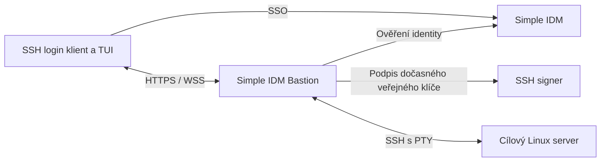

# Simple IDM Bastion — návrh a plán realizace

Datum: 3. 10. 2026. Stav: V1 implementována a automaticky ověřena;
Browser SSO, SSH, audit a návrat po exit jsou potvrzeny uživatelem;
MFA a nová obrazovka Ratatui ještě čekají na ruční akceptaci.
Určeno pro vlastní infrastrukturu a Datalite. Tento dokument předává kontext
dalšímu implementujícímu agentovi. Původní návrh níže zachovává kontext; skutečné kontrakty a konfigurace jsou
popsané v `BASTION.cs.md` a v příkladech konfigurací.

## Průběžný stav realizace

### Klávesa q — klient 0.11.3

- Přidáno `q` pro opuštění host listu; ve výběru účtu vrací do host listu.
  Esc zůstává pro návrat / zrušení. Filtr přijímá q jako běžný znak, SSH shell
  ho nadále dostává jako běžný vstup. Aktualizována nápověda a examples klienta.
- [x] Klient 0.11.3 sestaven, Clippy prošlo. PTY success/cancel ukončují
  návratový seznam pomocí q; error ověřuje Esc a panic obnovu terminálu.
  Všechny čtyři režimy prošly. Binárka: `target/debug/simple-idm-ssh-login`.
- [ ] Ruční ověření uživatelem; daemon se nemění.

### Návrat na vybraný host — klient 0.11.2

- Opraveno: stav host pickeru žije po celou dobu bastion režimu, nikoli pouze
  v jednom volání. Při návratu ze SSH / chyby / zrušeného připojení se zachová
  filtr, vybraný řádek a scroll offset. Fokus začíná v seznamu jako dosud.
- [x] Klient 0.11.2 sestaven, 11 unit testů a Clippy prošly. Rozšířená PTY
  regrese s 32 hosty prošla v režimech success/error/cancel/panic. Vybírá
  posledního hosta z filtrovaného seznamu a kontroluje zachování filtru,
  výběru i offsetu po návratu (při resize může Ratatui offset přizpůsobit).
  Lokální binárka: `target/debug/simple-idm-ssh-login`.
- [ ] Ruční ověření uživatelem v iTerm; daemon se nemění (0.2.2).

### Ukázka vstupu fingerprintu — bastion 0.2.2

- Průvodce ukazuje hostname cíle, příkaz na cíli, vzorový výstup ssh-keygen
  a přesnou část k vložení: pouze druhé pole `SHA256:...`. Výslovně vysvětluje,
  že se nevkládá celá řádka, délka klíče, účet/hostname ani typ klíče, a že
  příklad nesmí nahradit skutečný fingerprint cíle. Totéž je v examples/help.
- Změna je pouze textová; validace a ukládání klíčů se nemění.
- [x] Lokální sestavení 0.2.2 a nápověda ověřeny; fmt a diff check prošly.
- [ ] Linux binárku 0.2.2 sestaví a nasadí uživatel.

### Automatické hledání konfigurace — bastion 0.2.1

- Opraveno: `--config` je volitelné a přebíjí automatický výběr. Bez něj se
  hledá v OS konfiguračním adresáři uživatele (dirs::config_dir): nejprve
  `simple-idm-bastion/config.toml`, pak legacy `bastion.toml`; následně
  `/etc/simple-idm-bastion/config.toml` a `/etc/simple-idm-bastion/bastion.toml`.
  Linux respektuje XDG_CONFIG_HOME, macOS používá Library/Application Support.
- Nenalezená konfigurace skončí Clap chybou (exit 2), která ukáže hledané
  cesty a příklad `--config`. Neplatná explicitní cesta nikdy nepřepne na
  jiný config. Help/version/examples nepotřebují config ani jeho hledání.
- `add-host --yes` nyní přes Clap vyžaduje ID, name, address, environment,
  group a login. Bez --yes mohou chybějící údaje stále doplnit prompty průvodce.
- [x] Sestavení 0.2.1, dva nové CLI testy a Clippy prošly. Izolovaná CLI/PTY
  fixture potvrdila autodetekci OS user configu, Clap exit 2 pro neplatnou
  explicitní cestu i chybějící --yes argumenty, config-free examples a předchozí
  ukládání hostu/fingerprintu včetně zrušení průvodce. Lokální binárka
  `target/debug/simple-idm-bastion` má verzi 0.2.1.
- [ ] Nasazení nové Linux binárky uživatelem; samotné `add-host` pak najde
  `/home/bastion/.config/simple-idm-bastion/config.toml` bez argumentů.

### Přidávání hostů — daemon / CLI 0.2.0

- Implementováno: `simple-idm-bastion --config <file> add-host` s textovým
  interaktivním průvodcem; stejný příkaz podporuje argumenty a `--yes` pro
  automatizaci, `--dry-run` pro náhled bez změny konfigu/known_hosts a bez scanů.
  Ratatui není pro tento jednorázový průvodce další závislostí daemona.
- Přidává TOML blok bez přepisování existujících komentářů a formátu. Výsledek
  projde běžnou validací celé konfigurace; duplicitní ID a neplatné údaje odmítá.
  Editory se serializují samostatným souborem `<config>.edit.lock` (nesoutěží
  s běžícím daemonem), kontroluje změny zdrojového souboru. Zápis je atomický
  pro každý soubor, s původními oprávněními a unikátní `.bak-UUID` zálohou.
- Volitelný `--host-key-fingerprint SHA256:...` nebo fingerprint v průvodci:
  `ssh-keyscan -T 5 -t ed25519 -p <port> <address>` + `ssh-keygen -E sha256 -lf`.
  Klíč se uloží pouze při shodě s nezávisle ověřeným fingerprintem. Bez něj se
  known_hosts nemění. Trust CA a Linux účty na cíli se stále nastavují samostatně.
- known_hosts se ukládá před configem; při chybě následného zápisu configu může
  ověřený klíč zůstat přidaný. Jednotlivé zálohy jsou vypsané, nejde o transakci
  přes dva soubory. Restart služby nikdy neprovádí; uživatel jej udělá ručně.
- [x] Sestaven lokální macOS daemon 0.2.0; 9 unit testů prošlo a Clippy
  `--all-targets --no-deps -- -D warnings` prošlo. CLI fixture
  `crates/simple-idm-bastion/examples/verify-add-host.py` ověřila dry-run,
  uložení a zálohu, oprávnění, duplicitní ID, chybějící argumenty, skutečný
  SSH fingerprint a odmítnutí neshody. V PTY prošel textový průvodce při
  potvrzení i zrušení (nezměněný config). Fixture používá lokální klíč a
  izolovaný stub ssh-keyscan, neprovádí síťové scanování.
- Lokální binárka: `target/debug/simple-idm-bastion`; Linux release je potřeba
  sestavit přes `just release-linux-bastion` a nasadit uživatelem.
- [ ] Uživatel nasadí Linux binárku 0.2.0 a ručně ověří průvodce na routeru.
  SSH klient se tímto krokem nemění (0.11.1).

### Fokus seznamu a filtr `/` — klient 0.11.1

- Implementováno: výchozí fokus v seznamu; `/` aktivuje editaci filtru.
  Enter ve filtru pouze potvrdí filtr a vrátí fokus do seznamu, nikdy nepřipojí.
  Enter v seznamu připojí vybraný host/účet. Stejné ovládání v obou pickerech.
- Esc ve filtru zruší editaci a obnoví původní filtr i výběr. Ctrl-U filtr
  během editace vymaže. Běžné psaní v seznamu filtr nemění. Kurzor je vidět
  pouze ve filtru; rámeček a spodní nápověda ukazují aktivní fokus.
- [x] Klient 0.11.1 sestaven; 11 unit testů a Clippy prošly. PTY scénáře
  success/error/cancel/panic prošly: psaní v seznamu nemění filtr,
  `/production` + Enter potvrzuje filtr bez připojení, teprve další Enter
  otevře vybranou relaci. Zachována regrese myši a obnovy terminálu.
  Lokální binárka: `target/debug/simple-idm-ssh-login`.
- [ ] Ruční ověření uživatelem v iTerm. Daemon se nemění (0.1.1).

### TUI Ratatui — 4. 10. 2026

- Implementováno v klientovi `0.11.0`: přivítání, serverem ověřená identita,
  tenant, identifikátor bastionu, HTTPS endpoint a IP připojeného TLS endpointu.
  IP endpointu je adresa nginx dostupná klientovi (respektuje split DNS),
  nikoli vymyšlená IP loopback backendu.
- Implementováno: ohraničený filtr a tabulka Name / Hostname / IP address /
  Account / Environment, zvýraznění vybraného řádku, scrollbar při skutečném
  přesahu, počet filtrovaných/povolených hostů. Menší terminál vynechá sloupec
  Environment. Šipky, PageUp/Down, Home/End, Enter, Esc; stejné vykreslování
  pro výběr Linux účtu. Myš zůstává pro nativní výběr textu, bez mouse capture.
- Daemon `0.1.1`: aditivní metadata katalogu `identity`, `bastion`,
  `hosts[].address/port/resolved_ips`. Identita pochází z ověřeného access tokenu.
  DNS adresy se zjišťují na bastionu pouze pro autorizované hosty; lookup má
  timeout 1 s a nedostupné DNS nezablokuje výběr. Adresy jsou informační,
  připojení nadále kontroluje OpenSSH a known_hosts.
- Starý daemon je kompatibilní; klient výslovně ukáže nedostupnou identitu,
  místo jejího odhadování. Pro kompletní obrazovku je nutné nasadit daemon
  `0.1.1` i klienta `0.11.0`. Konfigurace ani signer se nemění.
- [x] Automatické ověření: klient 11 testů prošlo (1 ignored PTY fixture
  spuštěna zvlášť), daemon 7 testů prošlo; TestBackend ověřuje scroll k poslednímu
  hostu, záhlaví/metadata, Unicode filtr i terminály 80×24 / 40×12 / 12×4 / 1×1.
  PTY success/error/cancel/panic prošly, včetně návratu do seznamu, myších
  reportů bez opakovaného překreslování a obnovy terminálu. PTY emuluje DSR
  odpověď na dotaz Ratatui na kurzor. Clippy a sestavení obou binárek prošly.
- Lokální debug binárky: `target/debug/simple-idm-ssh-login` (0.11.0) a
  `target/debug/simple-idm-bastion` (0.1.1, macOS). Server potřebuje Linux build
  přes `just release-linux-bastion`; nebyl v rámci této změny nasazen.
  Na serveru po nahrazení binárky restartovat `systemctl --user restart
  simple-idm-bastion.service` a ověřit `--version`/journal.
- [x] Uživatel nasadil nový daemon a screenshotem potvrdil nové TUI:
  identita `mares`, tenant, bastion `intel-nuc-router`, endpoint
  `https://bastion.cloud-app.cz/`, TLS endpoint IP `31.31.74.141` a host
  `intel-nuc14.cluster` s DNS adresou `192.168.125.111` a účtem `mares`.
  Potvrzena cesta přes veřejnou IP; samostatný test z vnější sítě zatím
  nebyl doložen.
- [ ] Ručně ověřit filtrování, scroll většího katalogu a návrat po SSH
  `exit` v novém TUI 0.11.0.
- Návrh dalšího kroku (dosud neimplementován): na stránce úspěšného browser
  přihlášení odkaz „Sign out of SSO“ vedoucí na IDM. Ukončí aktuální browser
  SSO session a smaže její cookie; nezruší už vydané tokeny ani SSH relace.

### Nasazení a oprava klienta 4. 10. 2026

- Dohoda o verzování: při každé další úpravě `simple-idm-ssh-login` zvýšit
  jeho PATCH verzi (nebo MINOR pro odpovídající rozsah změny) a aktualizovat
  Cargo.lock. Klient `0.10.1` zahrnuje opravu macOS konfigurace, WSS provideru,
  obnovení terminálu při panic a nápovědy za hostname. Kontrola nasazení:
  `simple-idm-ssh-login --version`; samotný git hash nestačí pro necommitnuté změny.

- Ručně zprovozněno uživatelem: bastion na `intel-nuc-router.cluster` pod
  uživatelem `bastion` (systemd user + linger), nginx HTTPS/WSS
  `https://bastion.cloud-app.cz` → `127.0.0.1:9230`. IDM issuer
  `https://sso.cloud-app.cz`, signer `https://ssh-signer.cloud-app.cz`.
- Ověřeno uživatelem: browser SSO na macOS, access token a načtení katalogu
  s hostem `intel-nuc14.cluster`, Linux účtem/principalem `mares`, skupinou
  `ssh:principal:mares`. MFA průchod zatím není samostatně potvrzen.
- Po Enter klient skončil kódem 101, daemon neměl záznam o SSH relaci.
  Lokálně reprodukován Rustls panic: současně zapnuté `ring` (OIDC/reqwest
  0.12) a `aws_lc_rs` (reqwest 0.13); WSS neumělo vybrat process provider.
- Opraveno: CLI při startu explicitně instaluje AWS-LC provider. TLS/WSS
  regresní test před opravou padal se stejným panic a po opravě prošel;
  ověřuje i TLS ClientHello přes tungstenite proti lokální fixture.
- Opraveno: panic hook obnoví terminál před výpisem chyby; Drop guardu
  neopakuje opuštění alternate screen po obnovení hookem. PTY fixture
  success/error/cancel/panic prošly, panic diagnostika zůstává viditelná.
- Aktuální klientské testy: 9 passed / 1 ignored; ignored fixture byla
  ověřena samostatným PTY harnessem. Nově sestavená macOS binárka je
  `target/debug/simple-idm-ssh-login`.
- Opraveno: `<hostname> --help` i `<hostname> -h` zobrazují offline nápovědu
  bastionu místo chyby. Zkratka `<hostname>` i explicitní `bastion <hostname>`
  nadále fungují; nápověda uvádí obě podoby. Obě `--help` větve ověřeny s exit 0.
- [x] Zopakovat uživatelský Enter → vzdálený shell na skutečném nasazení:
  uživatel 4. 10. 2026 potvrdil s klientem `0.10.1` shell
  `mares@intel-nuc14:~$` přes bastion. Oprava WSS panic byla potvrzena
  skutečným připojením; browser SSO → katalog → podpis → SSH fungují.
- [x] Ručně ověřit `exit` → návrat do seznamu a záznam výsledku, konce
  a délky této relace v auditu: session `951f8f22-94b2-4277-80f3-161c618fc33f`,
  user/Linux účet `mares`, host `intel-nuc14.cluster:22`, result `exited`,
  exit status 0, duration 59074 ms. Návrat do pickeru potvrzen uživatelem.
- Oprava klienta `0.10.2`: picker překresloval celý terminál každých 50 ms
  i v klidu; po kliknutí/výběru myší uživatel viděl hromadně opakované řádky.
  Nyní se vykresluje pouze po změně vstupu nebo resize, události myši/focus
  překreslení nevyvolávají. Při vstupu do pickeru se obnoví alternate screen,
  plná scroll oblast a absolutní origin kurzoru po vzdálených programech.
  PTY regrese ověřuje klidový návrat do seznamu a myší reporty bez neustálého
  překreslování; původní klient test nesplnil.
- [x] Uživatel potvrdil v iTerm s `0.10.2`, že po `exit` a kliknutí/výběru myší
  seznam zůstává stabilní. Audit a SSH relace už jsou ověřené.

- Rozděleno na klienta/TUI, daemon/audit/SSH a izolovaný smoke test s dokumentací.
- Rozhodnuto: HTTPS/WSS klient, daemon na loopback HTTP za nginx TLS.
- Rozhodnuto: samostatný přístupový token s audience dedikovaného OIDC klienta
  bastionu a scope `bastion:connect`. Stejnou audience ověřuje delegovaný signer.
- Rozhodnuto: delegovaný signer endpoint `/ssh/sign/bastion` ověří současně
  uživatelský access token, tenant a servisní tajemství bastionu v hlavičce
  `X-Bastion-Key`. Tajemství se načítá z environment proměnné, nikoli z klienta.
- Rozhodnuto: API `/api/v1/hosts` a `/api/v1/terminal`, verzovaný WS protokol
  pro data/resize/ready/error/exit. Klientská konfigurace v `bastions.toml` vedle
  dosavadního `config.toml`, aby přímý SSH režim zůstal kompatibilní.
- Rozhodnuto: SQLite audit. Existující `audit::emit_event` jen loguje chyby
  zápisu a nemá vhodný kontrakt trvanlivého zahájení/ukončení relace.
- Implementováno: delegovaný signer, serverové tenant claims v authorization
  code/device/refresh tokenech, konfigurace bastionu, katalog a autorizace,
  SQLite audit a transport OpenSSH přes lokální PTY.
- Implementováno: klientský bastion režim, lokální TUI, řízení resize a WSS.
- Opraveno během nasazení: `bastions.toml` používá `dirs::config_dir()` stejně
  jako přímý SSH `config.toml`. macOS: `~/Library/Application Support/` a Linux:
  `$XDG_CONFIG_HOME` / výchozí `~/.config`. Původní V1 binárka měla natvrdo
  `.config` i na macOS; pro tuto opravu je nutné klienta znovu sestavit.
- Ověřeno: 75 unit testů core prošlo (4 existující integrační testy vyžadují
  samostatné PostgreSQL fixture a jsou ignored). Signer testuje skutečný SSH
  certifikát, pouze PTY extensions, audience/expiraci JWT a zúžení principals.
- Ověřeno: unit testy daemona (7) a klienta (8); Clippy nových/změněných CLI
  balíčků s `--all-targets --no-deps -- -D warnings` prošel. Celý core má
  existující Clippy nálezy mimo rozsah této změny.
- Ověřeno: skutečný lokální pseudoterminál klienta ve třech režimech
  success/error/cancel. Filtr a návrat do seznamu, Ctrl-C, UTF-8, resize
  a obnovení terminálu fungují (`examples/verify-terminal.py`).
- Ověřeno: `cargo check --locked --workspace` prošel.
- Ověřeno: živý daemon → signer → OpenSSH transport v izolované fixture;
  resize, Ctrl-C, audit, úklid klíčů a pokračování shellu po expiraci certifikátu.
- Ověřeno: kompletní `scripts/bastion-smoke.py --signer-bin ... --bastion-bin ...`
  přes důvěryhodnou TLS/WSS fixture a reálný OpenSSH. Prošly autorizace katalogu
  i přímého požadavku, tenant/audience/scope, změněný host key, UTF-8, resize,
  Ctrl-C, expirace, exit status, oddělené identity na sdíleném Linux účtu,
  audit před shell vstupem, délka, odpojení, nedostupný audit a restart.
  Exporty/filtry auditu a odstranění klíčů prošly.
- Ověřeno: příklady konfigurací, syntax nginx, finální sestavení tří binárek,
  `cargo fmt --all -- --check` a `git diff --check`.
- Browser SSO, SSH, audit a stabilní návrat do seznamu potvrzeny uživatelem.
  Zatím neověřeno: MFA, ruční interaktivní aplikace a nové TUI 0.11.0 v iTerm.

### Skutečné vstupní body pro dalšího agenta

- Implementace daemona: `crates/simple-idm-bastion/src/{main,config,server,ssh,audit}.rs`.
- Klient/TUI: `crates/simple-idm-ssh-login/src/{main,bastion,protocol}.rs`.
- Sdílené OIDC: `crates/simple-idm-core/src/ssh_login/oidc_browser.rs`.
- Delegovaný podpis: `crates/simple-idm-core/src/ssh_signer/` a signer CLI.
- Návody: `docs/BASTION.md`, `docs/BASTION.cs.md`.
- Konfigurace: `examples/config.example.bastion.toml`,
  `examples/config.example.bastions.toml`, `examples/config.example.ssh-signer.toml`.
- Nasazení: `examples/systemd/`, `examples/nginx/bastion.conf`; živé nasazení
  uživatelem viz stav výše, aktualizace TUI 0.11.0 / daemona 0.1.1 ještě čeká.
- Integrační fixture: `scripts/bastion-smoke.py` a `scripts/bastion-smoke.Dockerfile`.
- Skutečný klientský PTY test: `crates/simple-idm-ssh-login/examples/verify-terminal.py`.
- Přesné příkazy a potřebné proměnné jsou v návodech a v offline
  `simple-idm-bastion examples` / `simple-idm-ssh-login examples`.

## 1. Dohodnutý výsledek

Uživatel spustí:

```sh
simple-idm-ssh-login bastion.datalite.cz
```

Otevře se existující SSO přihlášení přes IDM (MFA podle politiky IDM), potom
lokální TUI se seznamem dostupných hostů. Uživatel filtruje seznam, vybere host,
stiskne Enter a dostane interaktivní shell. Po `exit` se vrátí do seznamu.
SSH klíče a certifikáty k cílovým serverům spravuje bastion; klient je nepotřebuje.

Schválené pořadí verzí:

| Etapa | Obsah |
|---|---|
| V1 | SSO, katalog a oprávnění, TUI výběr, interaktivní terminál, audit relací |
| V2 | TUI správce souborů a přenos souborů; propracovaný samostatný návrh UX |
| V3 | Port forwarding, až po správci souborů |
| Později | Případné časovače, uzamykání a další řízení relací |

Certifikát má typicky hodinovou platnost: určuje interval, ve kterém lze
zahájit SSH přihlášení. **V1 nebude ukončovat ani zamykat otevřenou relaci
kvůli stáří relace nebo expiraci certifikátu.** Audit měří dobu připojení,
ale toto měření není časový limit. Ani expirace přihlašovacího tokenu sama
neukončí již autorizovaný otevřený terminál. Nové připojení vyžaduje platné
přihlášení a novou kontrolu oprávnění. Hodina není slib hodinové možnosti
připojovat se po odvolání přístupu.

## 2. Rozdělení odpovědností

| Komponenta | Odpovědnost |
|---|---|
| `simple-idm-ssh-login` | OIDC přihlášení, TUI, lokální terminál, HTTPS/WSS spojení |
| nový `simple-idm-bastion` | Autorizace, katalog, relace, SSH klient, dočasné klíče a audit |
| `simple-idm-server` | Identity, skupiny, přihlašovací a MFA politika |
| `simple-idm-ssh-signer` | Ověření oprávněné žádosti a podpis uživatelského SSH certifikátu |
| cílový OpenSSH server | Ověření certifikátu a povolení přístupu k Linux účtu |



Bastion je důvěryhodný prostředník: vidí obsah terminálu a drží dočasný
privátní klíč k cílové SSH relaci. Klíč CA zůstává pouze u signeru.
HTTPS/WSS lze vystavit přímo s TLS nebo přes existující nginx. Web a SSH
cílového hostu nepotřebují odlišné veřejné DNS záznamy.

## 3. Co již existuje a co je potřeba změnit

Při přípravě návrhu byly ověřeny tyto části:

- `crates/simple-idm-ssh-login/src/main.rs`: existují subcommandy `login`,
  `ssh`, `status`, `logout`, `print-ssh-config` a profily konfigurace.
- `crates/simple-idm-core/src/ssh_login/commands.rs`: browser/device OIDC,
  vytvoření lokálního klíče, žádost o certifikát a jeho uložení.
- `crates/simple-idm-core/src/ssh_signer/handlers.rs`: signer ověřuje JWT
  a odvozuje principals ze skupin. `requested_principals` se aktuálně
  nepromítají do výsledku; nelze předpokládat hotové zúžení oprávnění.
- `crates/simple-idm-core/src/ssh_signer/jwt_validator.rs`: validace issueru,
  audience a podpisu; současný login posílá signeru ID token.
- `simple-idm-core` má auditní modul a podporu SQLite/PostgreSQL v SQLx.
  Před přidáním úložiště ověřit možnosti opětovného použití.

Zachovat dosavadní přímý SSH režim a jeho subcommandy. Bastion režim nesmí
automaticky vytvářet lokální SSH klíče přes dosavadní funkci `login()`.
Sdílet OIDC, validaci, konfiguraci a auditní infrastrukturu tam, kde odpovídají
novému účelu. Konkrétní SSH knihovnu vybrat až po ověření podpory uživatelských
OpenSSH certifikátů, ověřování host keys a PTY. Neimplementovat kryptografii.

## 4. Klient a konfigurace

Navržená konfigurace rozšiřuje existující profily; při implementaci zachovat
kompatibilitu se stávajícím souborem. Příklad nové části:

```toml
[bastions."bastion.datalite.cz"]
url = "https://bastion.datalite.cz:8443"
```

Zkratka s hostname vybere profil. Explicitní forma pro případ kolize se
jménem existujícího subcommandu:

```sh
simple-idm-ssh-login bastion bastion.datalite.cz
```

Neznámý profil nabídne srozumitelnou chybu a způsob konfigurace. Discovery
bastionu poskytne veřejnou OIDC konfiguraci; klient musí nejprve ověřit TLS
identitu nakonfigurovaného bastionu. Pro V1 stačí explicitní konfigurace
issueru/client ID, pokud discovery zbytečně rozšiřuje první etapu.

TUI zobrazí jméno hostu, prostředí, popis a povolený Linux účet. Psaní filtruje
lokálně načtený seznam, šipky vybírají, Enter připojuje, Esc opouští seznam.
Při více povolených účtech následuje výběr účtu. Připojování zobrazí průběh
nebo konkrétní chybu; nesmí zamrznout celé TUI. Po ukončení shellu se obnoví
TUI i stav terminálu. Ctrl-C během shellu patří vzdálenému programu.

## 5. Katalog a oprávnění

Pro V1 stačí konfigurační soubor na bastionu, bez nového administračního UI.
Ilustrační položka:

```toml
[[hosts]]
id = "grafana"
name = "Grafana"
address = "192.168.42.165"
port = 22
environment = "production"
allowed_groups = ["infra-admins"]
logins = ["{username}"]
```

Server mapuje ověřenou identitu na povolené Linux účty. `{username}` musí
pocházet ze serverem ověřeného a validovaného mapování. Pro sdílený účet
lze nastavit pevné jméno, například `postgres`; audit vždy zachová skutečnou
IDM identitu uživatele. Linux účty musí existovat na cílovém hostu.

Klient předává `host_id` a povolený účet. Nemůže poslat libovolnou IP, port
nebo principal. Bastion filtruje katalog podle oprávnění a kontrolu opakuje
při vytvoření každé relace. Server musí odmítnout i přímý požadavek na skrytý
host. Oprávnění se opírají o ověřenou identitu a skupiny; u tokenových skupin
explicitně dokumentovat zpoždění změn do obnovy tokenu. Nevydávat to za
okamžité odvolání přístupu a neobcházet pravidla tenantů.

## 6. Identita, signer a vznik relace

První implementační krok musí rozhodnout a otestovat kontrakt autentizace:

1. Znovu použít OIDC browser login s PKCE, state/nonce podle současné implementace.
2. Pro API bastionu definovat token s určenou audience a scopes. ID token
   určený klientovi automaticky nepovažovat za API token pro další služby.
3. Signer musí ověřovat identitu uživatele i oprávnění bastionu žádat za něj.
   Vybrat nejmenší podporovatelný kontrakt delegované žádosti; nepostačuje
   servisní token plus libovolný text `username` dodaný volajícím.
4. Zachovat současný přímý login/signer režim a testovat jeho kompatibilitu.

Po ověření požadavku bastion vytvoří dočasný klíč pro jednu relaci a získá
certifikát s TTL nejvýše podle politiky signeru, standardně 3600 sekund.
Signer odvodí principals z ověřené identity a případné požadované zúžení
smí pouze snížit oprávnění. Identifikátor certifikátu má umožnit korelaci
s auditním ID relace. Privátní klíč nesmí být společný všem uživatelům.

Bastion ověří SSH host key vůči spravovanému known_hosts nebo host CA;
výměna klíče musí skončit srozumitelnou chybou. Nepoužívat automatické
přijímání neznámých klíčů jako výchozí řešení. Potom otevře PTY a shell.
Při chybě, ukončení nebo odpojení se uklidí SSH spojení a dočasné klíče.
CA důvěra a principals se jednorázově nastaví na cílových SSH serverech.

## 7. Přenos terminálu a životní cyklus

Navržené API: veřejný discovery endpoint, autorizovaný seznam hostů a
autorizované otevření WSS terminálu pro konkrétní `host_id` a účet.
Přesná jména cest sjednotit s konvencemi projektu před implementací.

Protokol V1 musí mít verzi a rozlišovat binární terminálová data, změnu
velikosti okna, chybu a ukončení s exit statusem. Token posílat v autentizační
hlavičce nativního klienta, ne v URL. Pokud vznikne dvoufázové API s ticketem,
ticket musí být krátkodobý, jednorázový a svázaný s identitou a cílem.

Podporovat resize, UTF-8, interaktivní `vim`/`top`, Ctrl-C, EOF a backpressure
bez neomezeného bufferování. Keepalive detekuje ztracené spojení, není to
limit neaktivity uživatele. Případný nginx nesmí shazovat zdravý tichý terminál
kvůli nevhodnému timeoutu. V1 nepodporuje znovupřipojení k odpojené relaci.
Ukončení spojení není záruka ukončení všech procesů spuštěných na serveru
(např. `tmux`, `nohup`); audit měří připojení terminálu.

## 8. Povinný audit V1

Audit je trvalý strukturovaný záznam, nikoli jen provozní log do konzole.
Zaznamenat pokusy, zamítnutí, chyby připojení, úspěšný začátek a konec relace.

| Pole | Význam |
|---|---|
| `session_id`, `bastion_id` | Korelace celé relace a instance |
| `issuer`, `subject`, `tenant` | Jednoznačná ověřená identita |
| `username` | Čitelné jméno v okamžiku události |
| `host_id`, cílová adresa/port | Kam se skutečně připojovalo |
| `linux_user` | Pod jakým účtem |
| `client_ip` | Zdroj; proxy hlavičky jen od důvěryhodné proxy |
| `requested_at`, `connected_at`, `ended_at` | Časy v UTC |
| `duration` | Doba úspěšného připojení, v procesu měřená monotónně |
| `result`, `end_reason`, `exit_status` | Výsledek, odpojení/chyba/řádný konec |
| identifikátor certifikátu | Korelace se signerem |

Zahájení auditu uložit před zpřístupněním shellu; při nedostupném úložišti
novou relaci odmítnout s jasnou chybou. Ukončení ukládat idempotentně.
Po restartu označit nedokončené relace jako přerušené/neznámé ukončení;
nevymýšlet přesný čas ukončení ani přesnou délku při pádu procesu.
Způsob obnovy musí odpovídat počtu instancí, aby jedna instance neukončovala
v auditu relace jiné živé instance. Pro V1 stačí jedna instance bastionu.

Přednostně využít existující auditní infrastrukturu, pokud umožňuje uvedenou
trvanlivost a dotazy. Jinak navrhnout malé lokální SQLite úložiště pro bastion
s migracemi. Součástí V1 je administrátorský výpis/filtrování podle uživatele,
hostu, času a výsledku a export JSON/CSV. Ošetřit výpadek zápisu konce relace
(provozní chyba, retry a následná reconciliation), neskrýt ztrátu auditu.

Neukládat tokeny, privátní klíče ani obsah terminálu. Nahrávání terminálu
není součástí V1 a není totožné s auditem přístupů. Délku retence určit
konfigurací; dokumentovat zálohu a oprávnění k auditnímu úložišti.

## 9. Implementační kroky a ověření

- [x] Prověřit lokální instrukce, současný OIDC/signer/audit a závislosti.
      Uzavřít kontrakt tokenů, delegace, oprávnění a úložiště; zapsat rozhodnutí.
- [x] Přidat daemon, konfiguraci hostů a typovaný protokol. Testovat validaci
      konfigurace, filtrování a odmítnutí přímého neautorizovaného přístupu.
- [x] Implementovat dočasný SSH klíč, podpis, ověření host key a PTY transport.
      Ověřit proti izolovanému OpenSSH serveru s testovací CA.
- [x] Doplnit audit a životní cyklus včetně neúspěchu, souběžných relací,
      odpojení, restartu a nedostupného úložiště.
- [x] Rozšířit CLI o bastion režim, SSO a TUI. Zachovat přímé SSH subcommandy.
      Ověřit obnovení terminálu po chybě a návrat do seznamu po `exit`.
- [x] Ověřit automaticky katalog → WSS → shell → exit → audit s testovacím
      issuerem; velikost terminálu, Ctrl-C, neznámý host key, vypršelý token/
      certifikát, nepovolený účet a izolaci uživatelů/tenantů.
- [ ] Ruční akceptace browser login → MFA → lokální TUI → shell → exit → audit
      proti samostatnému testovacímu tenantu IDM v iTerm. Automatická fixture
      nepředstírá skutečný browser login. Vyzkoušet také `vim`/`top` a EOF.
- [x] Testem s krátkou platností certifikátu prokázat, že navázaný shell
      pokračuje po expiraci a nové přihlášení s prošlým certifikátem selže.
- [x] Doplnit anglický a český README, `examples`, konfigurace, nasazení
      daemona, nginx WSS příklad a nastavení cílového sshd.

Akceptace V1: uživatel zná jen profil bastionu, provede SSO, vidí pouze
povolené hosty, otevře plnohodnotný shell a po ukončení lze dohledat kdo,
kdy, kam, pod jakým účtem a jak dlouho byl připojen. Klient nepotřebuje
lokální SSH certifikát. Realizační testy provádět na izolovaných fixtures;
nasazení a změny skutečných serverů nejsou tímto plánem autorizovány.

### Reprodukovatelné kontroly

Z kořene repozitáře:

```sh
cargo check --locked --workspace
cargo test --locked -p simple-idm-core --lib -p simple-idm-bastion
cargo test --locked -p simple-idm-ssh-login --bin simple-idm-ssh-login
cargo clippy --locked -p simple-idm-bastion -p simple-idm-ssh-login -p simple-idm-ssh-signer --all-targets --no-deps -- -D warnings
cargo fmt --all -- --check
cargo build --locked -p simple-idm-bastion -p simple-idm-ssh-login -p simple-idm-ssh-signer
docker build -t simple-idm-bastion-smoke:local -f scripts/bastion-smoke.Dockerfile scripts
python3 scripts/bastion-smoke.py --signer-bin target/debug/simple-idm-ssh-signer --bastion-bin target/debug/simple-idm-bastion
```

Klientský `verify-terminal.py` potřebuje cestu k testovací binárce vypsané
příkazem `cargo test` (nikoli běžnou `target/debug/simple-idm-ssh-login`):

```sh
python3 crates/simple-idm-ssh-login/examples/verify-terminal.py target/debug/deps/simple_idm_ssh_login-<HASH>
```

Na macOS prošla success/error/cancel větev se skutečným controlling PTY.
Unit výsledky: core 75 passed / 4 ignored, daemon 7 passed, klient 8 passed /
1 ignored. Ignorovaný klientský test se spouští právě PTY harnessem; čtyři
core testy vyžadují vlastní PostgreSQL fixtures. Linux deployment/systemd
není vydáván za otestované živé nasazení; unit a konfigurace jsou příklady.

### Co zbývá před skutečným používáním

1. V testovacím IDM registrovat veřejného OIDC klienta s PKCE, povoleným
   loopback callbackem, scope `bastion:connect` a skupinovými claims.
2. Nastavit skutečné tenant UUID, shodnou audience klienta/daemona/signeru,
   servisní tajemství, katalog a ověřené SSH host keys podle `BASTION.cs.md`.
3. Ručně provést výše uvedenou browser/MFA/iTerm akceptaci. Produkční nasazení
   není součást této implementace a nebylo provedeno.

V1 má jednu instanci nad lokálním SQLite auditem. Skupiny se ověřují z tokenu,
změna oprávnění se projeví novým tokenem; otevřená relace se automaticky
neodvolává. LocalCommand potvrzuje SSH autentizaci, nikoli přijetí vzdáleného
shell requestu. Souborový přenos a forwarding zůstávají V2/V3.
Práce je v pracovním stromu, bez commitu.

## 10. Navazující verze

### Navazující oprava administračního UI: vlastní OAuth scopes

- [ ] Umožnit při vytváření i editaci OAuth klienta přímo v UI přidávat,
      upravovat a odebírat vlastní scopes, například `bastion:connect`, vedle
      běžných checkboxů `openid`, `profile`, `email`, `groups`, `offline_access`.
- [ ] Při načtení a uložení formuláře zachovat všechny existující vlastní
      scopes; nynější formulář je může při editaci zahodit. Sjednotit tuto
      podporu ve create/update handlerech, odstranit duplicity a ověřit roundtrip.
- [ ] Opravit zastaralý popisek o wildcard callbacku jen pro `cli-tools`;
      server podporuje loopback wildcard i pro ostatní klienty.

Požadavek uživatele z 3. 10. 2026: tuto změnu provést později, nyní pokračovat
v ručním zprovoznění bastionu. OAuth klient `simple-idm-bastion` na nasazení
již byl ručně aktualizován přes admin API na scope
`openid profile email groups bastion:connect`. Do opravy UI jej neukládat
přes současný edit formulář. Scopes nejsou skupiny: hostová autorizace
nadále používá podepsaný claim `groups` a katalogovou politiku bastionu.

### V2: TUI správce souborů

Uživatelský požadavek „SCP-TUI“ znamená přehledný přenos souborů. Protokol
vybrat při návrhu; SFTP je přirozený kandidát pro procházení adresářů a operace.
Nejprve navrhnout UX lokálního/vzdáleného umístění, upload/download, průběh,
rušení a konflikty názvů. Dva panely nejsou povinné. Opět použít katalog,
SSO, autorizaci a správu SSH relací; přidat audit souborových operací.
Přepsání a mazání souborů musí mít explicitní uživatelské chování.

### V3: Port forwarding

Až po V2. Navrhnout výběr povolené služby/cíle a lokálního portu, přehled
aktivních tunelů, ukončení a audit. Oprávnění pro shell automaticky neznamená
oprávnění tunelovat na libovolnou adresu; cíle určuje serverová politika.

## 11. Existující podobná řešení

Tato kategorie existuje: bastion / privileged access management.
Warpgate podporuje [OIDC SSO](https://warpgate.null.page/sso/) a
[SSH cíle a záznamy relací](https://warpgate.null.page/targets/ssh/).
Teleport má [audit SSH relací](https://goteleport.com/docs/reference/audit-events/ssh-sessions/).
Jsou inspirací; vlastní návrh má navázat na existující Simple IDM, signer
a požadovaný lokální TUI klient. Zmínka není rozhodnutím zavést další produkt.
